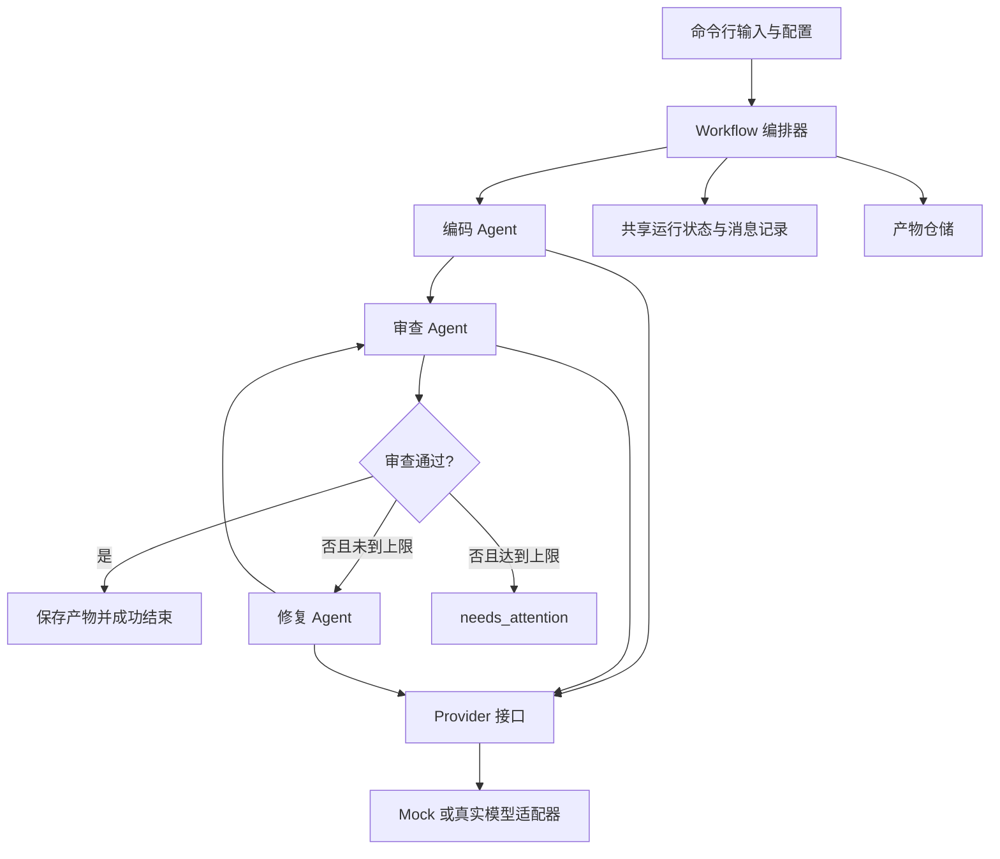

# 架构与接口设计

版本：1.0；日期：2026-10-22；状态：领域契约、Mock、仓储日志、三个 Agent、有界编排、CLI 与 HTTP Provider 均已实现。接口见 [基础模块](docs/MODULE_GUIDE.md)、[编排](docs/WORKFLOW_GUIDE.md)、[CLI](docs/CLI_GUIDE.md) 及 [HTTP](docs/HTTP_PROVIDER.md)。

## 1. 分层架构

采用 Python 单进程架构，以显式状态机编排三个 Agent。CLI 通过 run/demo 装配配置与 Provider，支持确定性 Mock 或兼容 Chat Completions 的 HTTP 服务。真实验收使用用户选择的 DeepSeek V4.1 Flash，服务别名为 deepseek-flash。运行代码无第三方依赖。

任一节点异常均交给编排器处理并进入 failed；示意图中省略重复异常边。最大两轮修复意味着最多一次编码、三次审查和两次修复，传输重试不创建额外逻辑节点。

## 2. 模块边界

| 模块 | 计划路径 | 职责 | 依赖 |
| --- | --- | --- | --- |
| 领域契约 | `src/se02/domain/` | 定义任务、消息、代码产物、报告和状态，执行结构校验 | 标准库 |
| 模型适配 | `src/se02/providers/` | 统一调用、Mock、HTTP、超时及可重试错误分类 | 领域契约；HTTP 实现依赖后定 |
| 角色实现 | `src/se02/agents/` | 编码、审查、修复的提示构造与结果解析 | 领域契约、Provider |
| 编排引擎 | `src/se02/workflow/` | 节点调度、分支、计数、状态迁移、消息产生 | 领域契约、角色接口、仓储接口 |
| 产物仓储 | `src/se02/storage/` | 独立运行目录、JSON、JSONL、原子文件写入 | 领域契约、文件系统 |
| 用户入口 | `src/se02/cli.py` | 输入校验、配置装配、进度及退出码 | 编排器及配置装配 |
| 验收资源 | `tests/`、`examples/` | 协议测试、离线场景、演示样例 | 对应被测模块 |

Agent 不直接写文件，也不调用其他 Agent；Provider 不参与状态迁移；CLI 不包含审查和修复规则。新增角色通过统一接口和角色注册表接入；新增流程需显式修改流程定义及相应验收用例，首期不支持任意 DAG。

## 3. 数据契约

| 对象 | 必要字段与约束 |
| --- | --- |
| Task | task_id、description、language（首期固定 python） |
| Message | schema_version=1、message_id、run_id、sender、receiver、kind、payload_ref、created_at |
| CodeArtifact | artifact_id、version（从 1 递增）、language、source、explanation、parent_version（初稿为空） |
| ReviewIssue | issue_id、severity、description、suggestion |
| ReviewReport | artifact_version、verdict、issues、summary |
| FixResult | code_artifact、changes（issue_id 与修改说明的映射） |
| RunState | schema_version=1、run_id、status、current_node、repair_count、artifact_refs、message_refs、started_at、ended_at、error |

运行中共享状态由编排器单独更新，角色接收输入快照并返回输出，避免共享可变对象的隐式写入。payload_ref 指向本次运行目录内的相对路径，仓储拒绝越界路径。时间使用带时区的 ISO 8601，界面按 Asia/Shanghai 展示。

## 4. 接口约定

- `Provider.complete(request) -> response`：request 包含角色提示、任务上下文和输出格式要求；响应为文本；超时与重试由 Provider 统一处理。
- `Agent.run(agent_input) -> agent_output`：各角色输入输出使用领域类型，异常统一转换为可识别的领域错误。
- `ArtifactStore.save_* / append_event / save_state`：返回相对路径引用；文件先写临时文件再替换；首次创建目录时生成不可冲突的 run_id。
- `Workflow.run(task, config) -> RunResult`：负责顺序调用、报告关联校验、消息及状态持久化，返回终态与结果目录。

编排器保存上游产物和消息后再启动下游；例如审查输入必须引用当前代码，修复输入必须同时引用该代码和对应 fail 报告。传输重试归属同一节点，事件记录 attempt 序号。

## 5. 状态与异常

运行正常迁移为 pending → running → succeeded / needs_attention / failed；启动前错误也允许 pending → failed，终态不允许再次变更。节点状态为 pending、running、completed、failed、skipped。审查通过且存在下一允许修复轮次时，记录该轮 skipped；多轮节点使用 review_0、repair_1、review_1 等执行 ID。默认修复上限两轮，可用 WorkflowConfig 降至 0 或 1。

节点完成前先校验响应结构和版本关系。磁盘失败不得宣告成功；无法保存 failed 状态时，RunResult.persistence_errors 返回诊断，CLI 人类输出到 stderr，JSON 模式写入结构化结果。首期不提供崩溃续跑。ExecutionEvent.phase 区分 node 与 provider；HTTP 重试由 context-local observer 转换为事件，落盘后再通知 CLI 进度回调。

## 6. 运行产物布局

计划每次运行保存在 `runs/<run_id>/`，包含 `task.json`、`state.json`、`messages.jsonl`、`events.jsonl`、`code/v1.py` 等版本文件、`reviews/review_0.json` 等报告，以及修复映射。失败保留已有文件。`runs/` 默认不入 Git；脱敏后的演示记录单独放入 `examples/results/` 并人工检查。

## 7. 验证策略

使用领域契约单元测试、Provider Mock 测试、角色契约测试及工作流集成测试。检查顺序、版本消费、循环边界和失败终态。真实模型冒烟测试单独运行，不作为离线测试的网络依赖。详细场景见 [验收文档](docs/ACCEPTANCE.md)。

## 8. 本地 Web 工作区

浏览器使用原生 HTML/CSS/JavaScript，三栏分别承担上传历史、文件上传与进度、产物查看；窄屏通过抽屉切换。Python 标准库 HTTP 服务提供同源 JSON 接口，单个后台工作线程调用现有 Workflow。网页轮询实际状态与产物，不另外实现 Agent 逻辑。

UI 运行有独立索引与产物目录，只展示自身登记的运行；保留历史但不支持断点恢复。真实模型配置保留在服务端，浏览器仅选择模式与修复预算。接口只绑定本机，并校验 Host、Origin、请求头与请求体。前端动态文本通过 textContent 写入，生成源码不执行。详细协议见 [WEB_UI.md](docs/WEB_UI.md)。

### 文件上传入口（0.3.1）

Web仅接收Python源码文件，将UTF-8文本构造为v1 CodeArtifact，通过Workflow.run(initial_code=...)直接进入审查；CLI仍保留原来的任务生成流程。上传入口不调用CodingAgent覆盖原文。两个入口共用审查/修复Agent、模型适配器、配置加载及有界循环。文件名只用于展示，保存路径由服务端生成；浏览器不配置API和模型。
