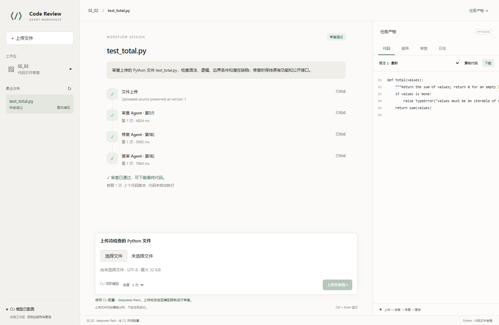
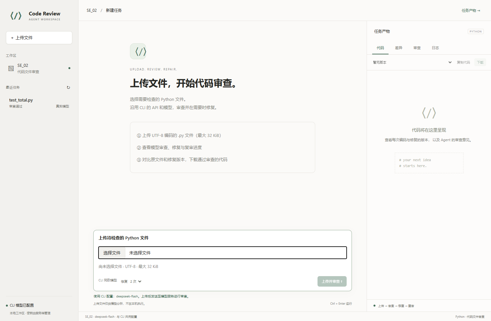
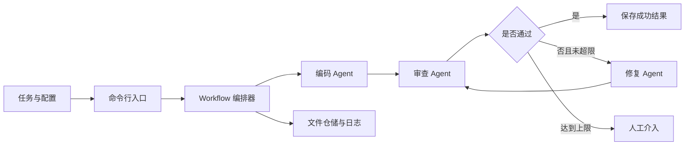

# SE_02：三 Agent 代码审查工作流

本项目拟构建一个可演示、可追踪的多 Agent 协作 MVP：接收编程任务，经编码、审查、修复和复审，输出代码候选稿、审查报告及执行记录。

**当前阶段：M1—M7 已交付。** 支持任务文件与配置、三个 Agent、有界修复编排、真实 HTTP 模型、进度与结果展示。已实际连接 DeepSeek V4.1 Flash 完成编码、审查、修复及 CLI 验收，提供可独立解压使用的源码包。

## 简洁前端工作区

已按第二次作业的界面设计实现交互式前端：暖白背景、绿色操作按钮、左侧任务历史、中间文件上传与审查进度、右侧任务产物。前端直接调用本项目工作流，无需 Node.js 或前端构建。

安装后启动：

```powershell
.\.venv\Scripts\python.exe -m se02.web --port 8763 --config config.example.toml
```

浏览器打开 http://127.0.0.1:8763 。终端按 Ctrl+C 停止。

1. 点击文件选择框，上传 UTF-8 编码的 `.py` 文件，最大 32 KiB。
2. 点击“上传并审查”。原文件直接保存为版本 1，模型审查后可按预算修复和复审，不先生成新代码覆盖上传内容。
3. 右侧切换代码版本、差异、审查和日志；审查通过后可复制或下载最终代码。
4. 左侧查看历史或上传下一个文件。手机宽度可切换历史和产物面板。

网页与 CLI 共用 `config.example.toml`、`load_config`、`HttpProvider`：API 为 `https://api.deepseek.com`，模型为 `deepseek-flash`（DeepSeek V4.1 Flash），密钥同样读取服务端 `SE02_API_KEY`。网页没有独立 API 配置、需求生成框或 Mock 选择；缺密钥时禁止提交，绝不切换为离线样例。

上传内容发送给该模型做静态审查和修复，不在本机运行代码或执行 pytest。历史会持久化，重启前未完成的任务显示失败。详见 [Web 使用与接口说明](docs/WEB_UI.md)。

截图采集于 2026-10-23，展示实际文件上传与模型审查：



新建任务页面：



原 CLI 只读报告仍可按下方步骤生成，与交互式工作区分别使用。

## 第一次使用：安装、运行、查看结果

1. 打开 PowerShell，进入仓库并安装：

   ```powershell
   Set-Location E:\python_project\SE\SE_02
   python -m venv .venv
   .\.venv\Scripts\python.exe -m pip install -e .
   ```

2. 先运行离线演示，不需要 API 密钥：

   ```powershell
   .\.venv\Scripts\python.exe -m se02 demo --scenario repair_pass
   ```

   应看到各节点进度、`Status: succeeded`、`Repairs: 1`、最终源码与审查报告。CLI 执行一次就退出，不是常驻服务。

3. 想直观看报告，执行：

   ```powershell
   .\.venv\Scripts\python.exe examples/runtime_report.py
   .\.venv\Scripts\python.exe -m http.server 8762 --bind 127.0.0.1 --directory runs/readme-preview
   ```

   浏览器打开 `http://127.0.0.1:8762/`。报告来自实际 CLI 调用，可以跳转到完整输出；刷新不会重新调用 Agent。按 Ctrl+C 停止预览服务。端口占用时，换一个端口并同步更改浏览器地址。

4. 使用自己的任务：把需求保存为 UTF-8 的 task.txt，例如“实现一个保留首次出现顺序的整数列表去重函数”。按下方“真实 DeepSeek 任务”配置密钥，然后运行：

   ```powershell
   .\.venv\Scripts\python.exe -m se02 run --task task.txt --config config.example.toml
   ```

   run 默认真实 HTTP 模型，缺配置会报错，不会静默切换 Mock。不要把密钥写入任务文件。Mock 只返回预置求和样例，不能证明任意需求已完成。

5. 查看终端给出的 Run directory：

   | 文件 | 用途 |
   | --- | --- |
   | state.json | 终态、修复次数与产物引用 |
   | code/v1.py、v2.py 等 | 各版本代码，历史不覆盖 |
   | reviews/review_0.json 等 | 每一版的审查判定和问题 |
   | fixes/fix_v2.json 等 | 问题 ID 对应的修改说明 |
   | messages.jsonl | 角色之间的数据传递记录 |
   | events.jsonl | 节点状态与 HTTP 尝试记录 |

   succeeded 表示当前版本审查通过；needs_attention 表示预算耗尽仍未通过；failed 表示调用、格式、版本或保存失败。代码只保存，不自动执行，使用前仍需人工检查。

常用参数：`--max-repairs 0/1/2` 调整预算，`--output-dir PATH` 指定目录，`--json` 输出机器可读结果，`--quiet` 关闭进度。`python -m se02 run --help` 查看完整参数。退出码：成功 0、失败 1、输入/配置错误 2、需人工处理 3。

## 系统设计思路

把“角色能力”和“执行顺序”分开：编码 Agent 生成初稿，审查 Agent 按任务检查当前版本，修复 Agent 消费失败报告并生成下一版；Workflow 决定接下来调用谁，最多两轮修复。三个角色可以共用模型服务，但提示、输入和输出职责独立。



- **契约保证边界**：任务、代码、报告与状态使用严格校验的不可变对象。审查必须绑定当前版本，修复必须新增版本并回应问题 ID。
- **Provider 隔离模型**：Agent 通过统一接口使用 Mock 或 HTTP 服务，Provider 处理超时、重试和异常分类，编排器不依赖厂商 SDK。
- **记录保证可追溯**：每次运行独立目录，先保存产物再发送消息引用，保留全部版本与日志。传输重试与修复次数分开计数，错误不能伪装成成功。

## 开发位置

- 本地工作目录：`E:\python_project\SE\SE_02`
- 远程仓库：https://github.com/NAKADAO0/SE_02
- 所有新增源代码、测试和文档均放在本仓库中。
- 相邻目录第二次作业仅作为界面风格参考；本工作区复用 SE_02 的领域、Agent 与编排模块。

## 文档导航

| 文档 | 内容 |
| --- | --- |
| [项目目标](docs/PROJECT_GOALS.md) | 产品定位、范围、成功标准、作业要求映射 |
| [产品需求](docs/PRD.md) | 用户流程、功能优先级、异常规则、验收标准 |
| [架构设计](Design.md) | 模块边界、数据契约、状态机、流程图 |
| [模块化开发流程](docs/DEVELOPMENT_WORKFLOW.md) | 开发顺序、模块任务、依赖、提交与集成方式 |
| [验收与交付](docs/ACCEPTANCE.md) | 验收场景、评分映射、交付检查 |
| [模块详细说明](docs/MODULE_GUIDE.md) | 安装、数据契约、Mock 场景、仓储接口、日志及异常 |
| [M1/M2 实现报告](docs/IMPLEMENTATION_REPORT.md) | 领域契约和基础设施的历史验证证据 |
| [Agent 与编排说明](docs/WORKFLOW_GUIDE.md) | 角色接口、执行顺序、分支、两轮修复、失败处理与扩展 |
| [M3/M4 验证报告](docs/WORKFLOW_REPORT.md) | 本轮新增功能、55 项测试及后续范围 |
| [Web 工作区](docs/WEB_UI.md) | 启动、操作、历史与本地 HTTP 接口 |
| [CLI 使用说明](docs/CLI_GUIDE.md) | 任务文件、配置优先级、进度、结果和退出码 |
| [HTTP 适配说明](docs/HTTP_PROVIDER.md) | 协议、超时、重试、错误分类和凭据边界 |
| [最终验收报告](docs/FINAL_ACCEPTANCE.md) | 88 项测试、真实服务和交付证据 |
| [打包说明](docs/PACKAGING.md) | 源码包、SHA256、白名单和独立解压验收 |

## 快速验证（PowerShell）

要求 Python 3.11+；本次在 Windows、Python 3.12.0 验证。运行模块和测试仅使用标准库。安装构建工具时可能需要联网。

```powershell
Set-Location E:\python_project\SE\SE_02
python -m venv .venv
.\.venv\Scripts\python.exe -m pip install -e .
.\.venv\Scripts\python.exe -m unittest discover -s tests -v
.\.venv\Scripts\python.exe -m se02 demo --scenario repair_pass
```

示例默认跑通“编码 → 审查拒绝 → 修复 → 复审通过”，在 `runs/<run_id>/` 保存历史代码、报告、消息和终态。可选场景为 direct_pass、repair_pass、always_reject、call_failure；退出码分别为 0、0、3、1。`--max-repairs` 可设为 0、1、2，默认 2。详细接口见 Agent 与编排说明。

Mock 使用固定求和样例，不需要密钥或网络。真实模型读取任务文件，使用下面的 run 命令。旧 infrastructure_demo 仍是基础模块检查点，workflow_demo 为旧版离线 API 示例。

完全离线、不安装包也可使用：先运行 `$env:PYTHONPATH = 'src'`，再用 `python -m unittest discover -s tests -v` 和 `python examples/workflow_demo.py --scenario direct_pass`。

## 真实 DeepSeek 任务

示例配置已填写官方地址和模型别名。密钥只放当前进程环境，不写入 TOML；PowerShell 可用安全输入方式注入：

```powershell
$credential = Read-Host 'DeepSeek API key' -AsSecureString
$env:SE02_API_KEY = [System.Net.NetworkCredential]::new('', $credential).Password
.\.venv\Scripts\python.exe -m se02 run --task examples/tasks/sum.txt --config config.example.toml
```

安装后也可执行 `.\.venv\Scripts\se02.exe run ...`。默认网络超时 60 秒、重试一次、最多两轮修复；终态为 succeeded / failed / needs_attention。`--json` 输出机器可读结果，进度在 stderr；`--quiet` 关闭进度。代码仅保存，不自动执行。
