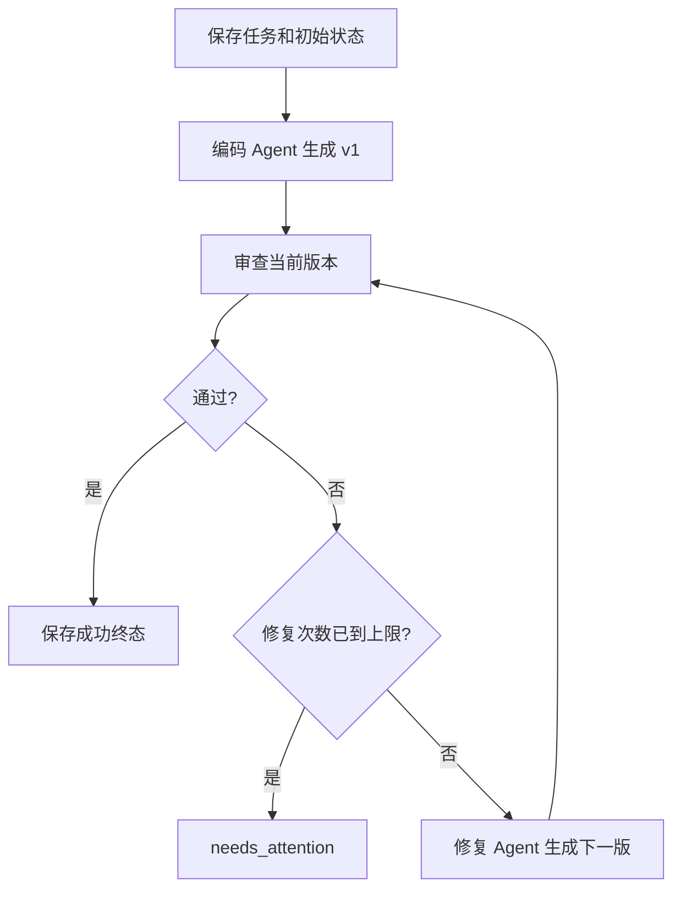

# Agent 与编排引擎使用说明

日期：2026-10-22；对应 M3/M4。目录：`E:\python_project\SE\SE_02`。

本模块提供三角色工作流：编码 → 审查 → 按需修复 → 复审，默认最多两次修复。现已接入真实 HTTP Provider 与通用 CLI，见 [CLI](CLI_GUIDE.md) 和 [HTTP 说明](HTTP_PROVIDER.md)。本文的旧脚本仍仅演示 Mock。

## 当前版本补充

M5/M6 已提供 HTTP 超时、重试和进度回调；下文 M3/M4 的“后续”描述保留为阶段设计背景，最新验收以 [最终报告](FINAL_ACCEPTANCE.md) 为准。逻辑节点事件 phase=node；传输尝试 phase=provider，不能将 provider 完成数等同于 Agent 调用数。

## 1. 安装与运行

PowerShell：

```powershell
Set-Location E:\python_project\SE\SE_02
python -m venv .venv
.\.venv\Scripts\python.exe -m pip install -e .
.\.venv\Scripts\python.exe -m unittest discover -s tests -v
.\.venv\Scripts\python.exe examples/workflow_demo.py --scenario repair_pass
```

已有虚拟环境可直接使用后两条命令。运行代码只使用标准库，Python 要求 3.11+，本次实测 3.12.0；安装构建工具首次可能联网。完全离线时设置 `$env:PYTHONPATH = 'src'`，使用 `python` 执行测试和示例即可。

| 场景 | 调用顺序 | 终态 | 退出码 |
| --- | --- | --- | --- |
| direct_pass | 编码、审查 | succeeded | 0 |
| repair_pass | 编码、审查、修复、复审 | succeeded | 0 |
| always_reject | 编码、审查、修复1、复审1、修复2、复审2 | needs_attention | 3 |
| call_failure | 编码调用失败 | failed | 1 |

示例参数 `--max-repairs` 可为 0、1、2，默认 2；例如 `--scenario always_reject --max-repairs 1` 在一次修复后结束。非法参数退出码为 2。`--root` 指定运行产物根目录，默认 runs。

示例打印一行 JSON，含 state、run_dir、final_code_ref、final_review_ref、persistence_errors、exit_code 和 `mode="mock-workflow"`。可按 run_dir 查看所有历史。该脚本演示固定求和需求；用户任务文件读取、模型配置和通用 CLI 属于 M5/M6。

## 2. 三个角色

共同接口为 `Agent.run(agent_input) -> AgentOutput`，其中 AgentInput 为不可变契约，包含 task、可选 code 和 review。AgentOutput 为 CodeArtifact / ReviewReport / FixResult 之一。

| 实现 | role | 输入 | 输出与校验 |
| --- | --- | --- | --- |
| CodingAgent | coder | task | CodeArtifact；必须为初始 v1 |
| ReviewAgent | reviewer | task、当前 code | ReviewReport；必须绑定该代码版本 |
| RepairAgent | fixer | task、当前 code、对应 fail review | FixResult；下一代码版本且 changes 精确覆盖所有问题 ID |

每个角色使用独立 system_prompt，说明任务边界、输出字段、版本和审查规则。调用时输入对象直接进入 ProviderRequest，不通过拼接不明确的共享文本来传递状态。Provider 接口和现有 Mock 兼容。

响应解析要求一个严格 JSON 对象：拒绝 Markdown 代码围栏、重复字段、NaN/Infinity、未知字段、缺失字段、不匹配类型和无效业务关系。错误响应不自动修剪、重试或转成成功对象。ProviderError 原样向编排器传播，输出协议问题表现为 ValidationError。

Agent 不读写产物文件，不调用其他角色，不执行生成代码，也不自行判断整个工作流是否成功。

## 3. 在代码中运行工作流

```python
from se02.domain import Task
from se02.providers import MockProvider
from se02.workflow import Workflow, WorkflowConfig

workflow = Workflow(MockProvider("repair_pass"), root="runs")
result = workflow.run(
    Task(task_id="sum-example", description="实现 total(values)，空列表返回 0"),
    WorkflowConfig(max_repairs=2),
)
assert result.state.status == "succeeded"
assert result.state.repair_count == 1
assert result.final_code_ref == "code/v2.py"
assert result.final_review_ref == "reviews/review_1.json"
print(result.run_dir)
```

WorkflowConfig 只包含 max_repairs，限制为整数 0、1、2，拒绝布尔值和字符串。`Workflow.run(task, config=None)` 默认为两次修复；同一 Workflow 可以顺序运行多次，每次创建独立 UUID 目录及执行上下文，不共享修复计数或产物引用。

RunResult 是可 JSON 编解码的不可变契约，state 必须是终态，run_dir 为绝对路径，产物引用为运行目录内相对路径。`exit_code` 是由终态计算的属性，不存储在契约 to_dict 中；示例输出时单独加入该值。

- succeeded：审查通过，必要产物、消息、完成事件及成功状态已保存。
- needs_attention：最新审查仍失败，已用完配置允许的修复次数。
- failed：调用、解析、校验、角色实现或保存发生异常。
- final_code_ref：最近一次完整保存的新代码引用。
- final_review_ref：当前代码的最近一次完整保存的报告；新版本保存后先清空，复审成功保存后再更新，避免把旧报告当作新版本结论。
- persistence_errors：错误事件或错误状态无法写入时的补充诊断；此时返回的失败状态可能没有完整落盘，必须保留这些诊断。

`final_review_ref` 不表示报告通过。例如 needs_attention 会指向最后的 fail 报告；failed 时也可能存在已保存的报告，需要结合 state.error 判断。

## 4. 调度规则和次数



任一步骤抛出异常则停止下游并进入 failed 处理，图中省略异常边。

默认执行节点 ID 为 coder、review_0、repair_1、review_1、repair_2、review_2。最多 6 次角色调用：一次编码、三次审查、两次修复。上限 0 时仍执行编码和首次审查，只是不进入修复。

repair_count 表示已开始的修复节点次数，在进入 repair_N 时持久化更新；该节点调用失败也计为已开始一次。配置上限触发时，needs_attention 可对应 0、1 或 2 次修复。

已通过且仍存在下一允许修复轮次时，记录该轮的 skipped 事件；例如首次通过记录 repair_1 skipped，第二次审查通过记录 repair_2 skipped。通过第二轮复审时不会创建 repair_3。关闭修复（max_repairs=0）时没有修复节点事件。

## 5. 消息、状态和产物

数据先通过仓储保存，再创建引用它的消息；实际调用输入使用同一领域对象。典型流转：

1. 用户任务 → 编码角色。
2. 任务与当前代码 → 审查角色。
3. 审查报告 → 编排器进行分支判断。
4. 需要修复时，任务、当前代码、失败报告 → 修复角色。
5. 修复结果 → 编排器；新版本代码与任务 → 审查角色。

每条消息均有独立 ID、run_id、sender、receiver、kind、payload_ref 和时间，写入 messages/<id>.json 及 messages.jsonl。修复后的代码发送方为 fixer，初始代码发送方为 coder。

每个调用节点先保存当前运行快照，再记录 running；返回值经校验和保存后记录 completed，再同步状态。事件含节点 ID、代码版本、耗时、时间和 attempt=1。本轮不做传输重试，因此重试计数没有被误算为修复次数。

state.json 保存所有已登记产物和消息引用。代码同时登记 .py 与 .json 元数据；修复还登记 fixes/fix_vN.json；所有历史文件保留。例：

```text
runs/<run_id>/
├── task.json
├── state.json
├── code/v1.py、v1.json、v2.py、v2.json
├── reviews/review_0.json、review_1.json
├── fixes/fix_v2.json
├── messages/<id>.json
├── messages.jsonl
└── events.jsonl
```

本地 runs 不提交 Git，不自动执行源码。仓储的单写入者、单文件原子发布、多文件非事务边界仍适用，详见 [基础设施说明](MODULE_GUIDE.md)。

## 6. 失败处理

运行目录创建之前的参数错误抛 ValidationError，目录无法创建抛 StorageError；此时无法伪造运行记录。目录创建后，编排器捕获普通 Exception，包括 ProviderError、ValidationError、StorageError 和意外的适配器异常，停止后续调用。

失败处理分别尝试写失败事件和 failed 状态，不因前者失败而放弃后者。返回 state.error 记录原始异常类型及描述；补充写入失败放入 persistence_errors。中断类异常 KeyboardInterrupt/SystemExit 不吞掉，进程终止时可能留有 running 状态，当前不支持恢复运行。

成功状态采用“保存成功后才更新内存状态”。若成功快照写入失败，会尝试保存 failed，而不是返回 succeeded。日志失败同样不能返回成功。

新版本保存后复审失败时，final_code_ref 可指向新版本，但 final_review_ref 为空，旧报告仍在历史列表中。不要只看到代码文件存在就判定运行通过。

## 7. 替换角色与模型

角色注册表支持覆盖现有 coder/reviewer/fixer。每个对象必须具备对应 role 和可调用 run；编排器再检查输出类型、初始版本及跨对象关系，避免自定义角色绕过协议：

```python
from se02.agents import ReviewAgent
from se02.providers import MockProvider
from se02.workflow import Workflow

custom_reviewer = ReviewAgent(MockProvider("always_reject"))
custom_workflow = Workflow(
    MockProvider("direct_pass"),
    agents={"reviewer": custom_reviewer},
)
```

这是固定流程的角色替换机制，不是任意 DAG 编辑器；新增第四种流程节点仍需修改流程定义及验收。自定义 Agent/Provider 若保留可变状态，自身需保证调用隔离；不承诺同一实例的并发安全。

真实模型适配器只需实现 Provider.complete；超时、服务端重试及鉴权策略属于后续 M6。本轮 Mock 是固定求和样例，能证明调度与协议行为，不能证明任意任务的模型编码、审查或修复质量。

## 8. 验证入口

`test_agents.py` 验证提示、上下文和严格响应；`test_workflow.py` 验证调用顺序、版本消费、0—2 次上限、角色替换、运行隔离和故障；`test_workflow_example.py` 用真实子进程验证四场景的 JSON、终态和退出码。完整证据见 [本轮实现报告](WORKFLOW_REPORT.md)。
